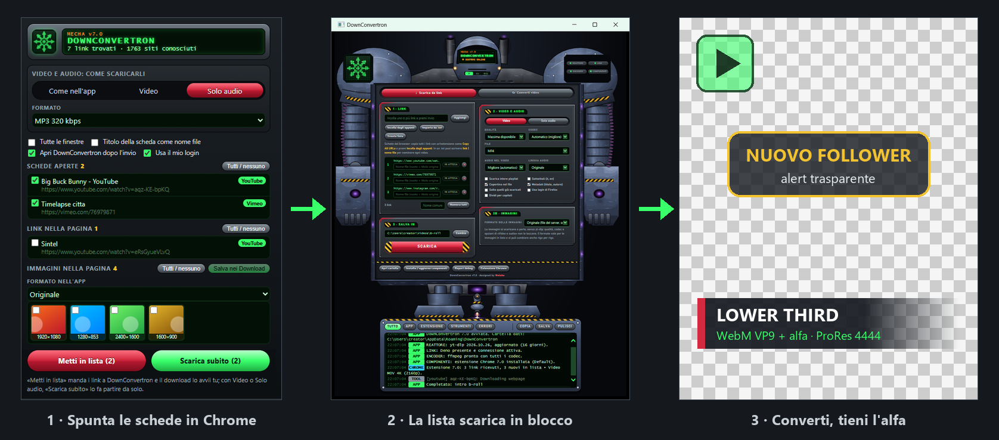
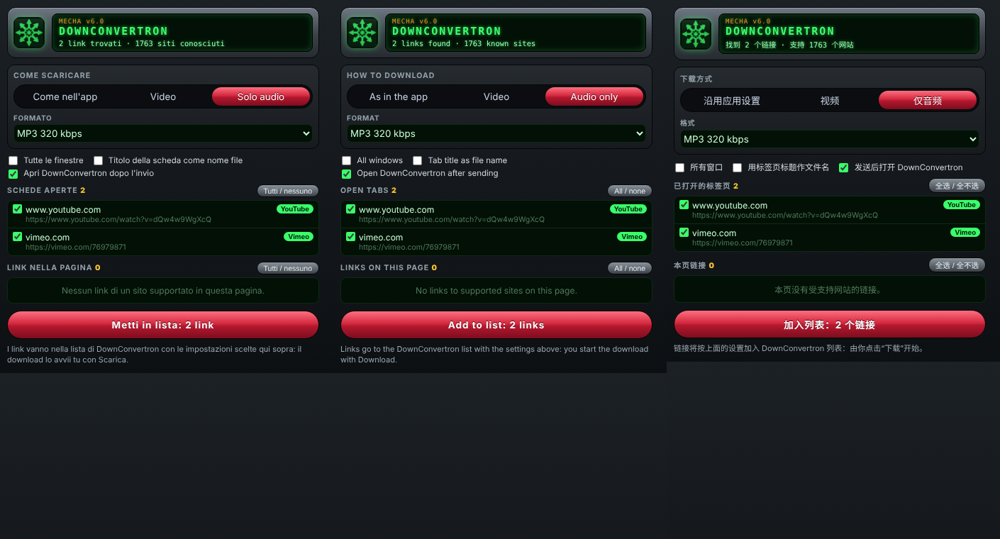
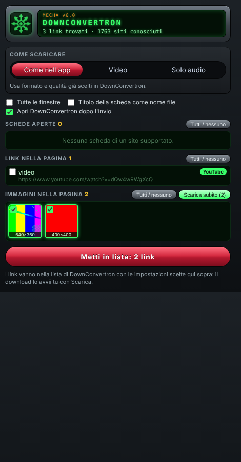
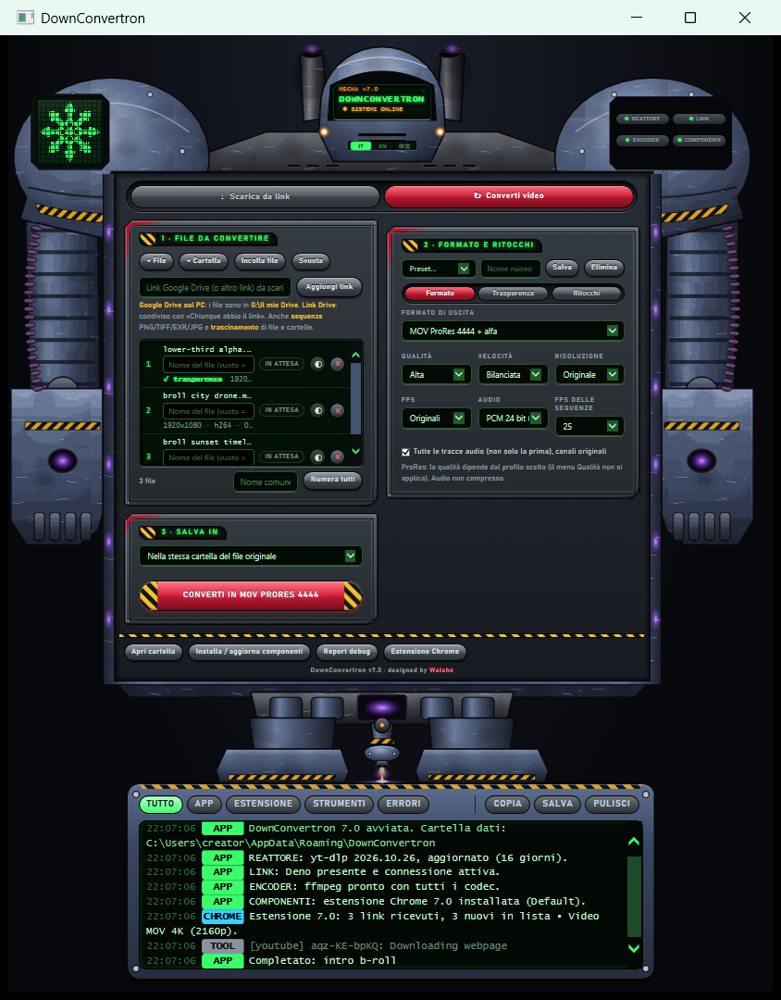
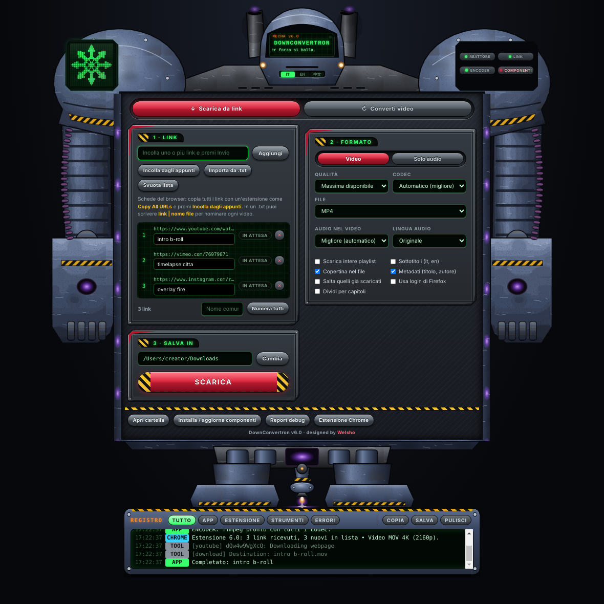
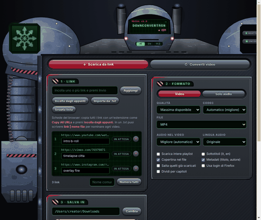

[English](README.md) · Italiano

# DownConvertron

**Scarica in blocco dal web video, audio e immagini. Convertili senza perdere il canale alfa.**
Un front end per yt-dlp e ffmpeg, pensato per creator, streamer e video maker.

- **In blocco, in pochi clic**: incolla una lista di link, oppure manda le schede aperte e le immagini di una pagina dall'estensione Chrome. Video, solo audio, immagini.
- **Converti e conserva la trasparenza**: WebM VP9 + alfa, ProRes 4444, HAP Alpha, WebP e APNG animati, sequenze PNG/TIFF/EXR.
- **Dalle immagini agli overlay**: più immagini diventano un'animazione o una sequenza, pronta per OBS, Premiere, Resolve e i ledwall.

**7.0 beta** · Windows 10/11 · macOS 13+ su Apple Silicon · Estensione Chrome · [Cosa è stato provato](#stato)

[Scarica](https://github.com/welsho/DownConvertron/releases) · Interfaccia in italiano, inglese e 简体中文

[](https://github.com/welsho/DownConvertron/actions/workflows/build.yml)
[](https://github.com/welsho/DownConvertron/releases)
[](LICENSE)



Sì, l'interfaccia è un mecha. Si gira quando gli trascini sopra un file.

## Cosa fa

- **Raccoglie i link dal browser.** L'estensione Chrome elenca le schede aperte, i link della pagina e le immagini della pagina. Li spunti, poi **Metti in lista** o **Scarica subito**, con formato e qualità già scelti.
- **Video, audio e immagini nella stessa lista.** Video e audio passano da [yt-dlp](https://github.com/yt-dlp/yt-dlp), dai siti che yt-dlp supporta (oltre 1.700 extractor; alcuni smettono di funzionare quando un sito cambia). Le immagini arrivano dai link diretti, salvate come sono oppure in PNG, WebP o JPG, con un riquadro di impostazioni tutto loro.
- **Conserva la trasparenza in ogni formato che la supporta.** WebM VP9 + alfa, ProRes 4444 e 4444 XQ, Animazione, PNG in MOV, CineForm, HAP Alpha, WebP e APNG animati, sequenze PNG/TIFF/EXR. I formati senza alfa (MP4 H.264/H.265, ProRes 422, JPG) sono indicati come tali; con il JPG le parti trasparenti diventano bianche.
- **Trasforma le immagini in animazioni.** Più immagini diventano un'unica animazione, con le immagini al secondo che scegli, oppure restano separate (l'app te lo chiede). Una sola immagine diventa una clip ferma della durata che imposti, o un altro file immagine.
- **Ritocca.** Taglio, ripetizioni, avanti-indietro, tela verticale / quadrata / 4:5 con bordi trasparenti, chroma key, anteprima su scacchiera, normalizzazione del volume (-14, -16 o -23 LUFS).
- **Usa la scheda video quando c'è.** Encoder NVIDIA, Intel e AMD su Windows, il chip Apple sul Mac.
- **Gira sul tuo computer.** Nessun account, nessuna telemetria, nessun nostro server. [Cosa fa sulla tua macchina](#prima-di-installare).

## Flussi di lavoro

**1 · B-roll in blocco.** Apri le clip in Chrome mentre fai ricerca → icona di DownConvertron → *Video*, contenitore e qualità → **Metti in lista**, poi **Scarica** nell'app (oppure **Scarica subito** e parte da solo). Usalo per le clip dei tuoi canali, dei siti di stock e delle librerie di cui hai la licenza.

**2 · Overlay e alert per lo stream.** Trascina sul mecha un MOV con alfa → *WebM VP9 + alfa* per le browser source di OBS, *ProRes 4444* per il montaggio, *HAP Alpha* per media server e ledwall. Controlla il risultato nell'anteprima su scacchiera prima di convertire.

**3 · Dalle immagini all'animazione.** Trascina sul mecha un gruppo di PNG → rispondi *un'unica animazione* → scegli le immagini al secondo nella riga → *WebP animato*, *APNG*, *WebM VP9 + alfa* oppure una sequenza numerata.

**4 · Loop, stinger e clip verticali.** Taglio, *Avanti-indietro* per un loop senza stacco, *Ripetizioni* per allungarlo, *Tela 1080×1920* con *Intero, bordi trasparenti*.

**5 · Musica e voice-over.** *Solo audio*: WAV per il montaggio, MP3 per le bozze, oppure la traccia originale senza conversione.

## Installazione

Tutti i file sono nella [pagina delle release](https://github.com/welsho/DownConvertron/releases). È una pre-release: l'app per Windows e l'app per Mac sono state provate dai beta tester. I dettagli sono in [Stato](#stato).

### Windows 10 / 11
1. Scarica `DownConvertron-Setup.bat` e aprilo con un doppio clic.
2. Windows SmartScreen ti avvisa perché il file non è firmato: *Ulteriori informazioni → Esegui comunque*. Anche alcuni antivirus lo segnaleranno. [Cosa fa l'installer](#prima-di-installare).
3. Apri DownConvertron. Se una spia in alto è rossa, cliccala: installa o aggiorna quel componente.

L'installer ha bisogno di *Programma di installazione app* (winget), che Windows 10 e 11 di norma includono. L'app non chiede diritti di amministratore. Non vuoi installare? `DownConvertron.hta` è tutta l'app in un solo file: doppio clic, poi **Installa / aggiorna componenti**.

### Mac (Apple Silicon, macOS 13 o successivo)
1. Scarica `DownConvertron-Mac-AppleSilicon.zip`, aprilo e trascina **DownConvertron.app** in *Applicazioni*.
2. Aprila. Il Mac dice che non può verificare lo sviluppatore, oppure che l'app è danneggiata. Non è firmata con un Developer ID Apple e non è notarizzata: il messaggio vuol dire questo. Vai in *Impostazioni di Sistema → Privacy e sicurezza → Apri comunque*.
3. Se il Mac rifiuta ancora, apri il Terminale ed esegui `xattr -dr com.apple.quarantine /Applications/DownConvertron.app`. Toglie il contrassegno che macOS mette ai file scaricati; non cambia nient'altro.
4. Premi **Installa / aggiorna componenti**: yt-dlp, ffmpeg e Deno (circa 150 MB) vanno in `~/Library/Application Support/DownConvertron/bin`. Niente Homebrew, niente password.

Se un passaggio non va come scritto, [facci sapere com'è andata](https://github.com/welsho/DownConvertron/issues/new/choose).

### Estensione Chrome
1. Nell'app premi **Estensione Chrome**: prepara la cartella dell'estensione, apre la pagina *Estensioni* di Chrome e mostra la cartella da caricare.
2. Attiva la *Modalità sviluppatore* e trascina la cartella nella pagina. Una volta sola.

L'estensione non è sul Chrome Web Store: si carica dalla cartella che prepara l'app, quindi Chrome mostra il suo solito avviso sulle estensioni in modalità sviluppatore. Chrome non permette a nessun programma di installare un'estensione al posto tuo: per questo restano quei due passaggi. [A cosa può accedere](#estensione-chrome-permessi-e-login).

<p align="center"><br></p>

## Prima di installare

Non è firmato. Ecco, voce per voce, cosa fa sul tuo computer e come toglierlo.

- **Installer per Windows**: un file `.bat` che esegue uno script PowerShell contenuto al suo interno (`-ExecutionPolicy Bypass`). Alcuni antivirus segnaleranno questo schema. Installa o aggiorna yt-dlp, ffmpeg e Deno con winget (`yt-dlp.yt-dlp`, `yt-dlp.FFmpeg`, `DenoLand.Deno`), copia l'app in `%LOCALAPPDATA%\Programs\DownConvertron`, crea i collegamenti sul Desktop e nel menu Start, registra il link `downconvertron://` sotto `HKCU` e toglie le versioni precedenti di questa app (DownLTransFMecchazzi, Mecchazzi, Scarica Video) conservandone le impostazioni.
- **App per Windows**: un'HTA, eseguita da `mshta.exe` di Windows con i diritti del tuo utente e senza la sandbox di un browser. A ogni avvio scrive due voci di registro, solo per il tuo utente: `HKCU\Software\Classes\downconvertron` e `HKCU\Software\Google\Chrome\NativeMessagingHosts\com.welsho.downconvertron`. I suoi dati stanno in `%APPDATA%\DownConvertron`. Il file unico `DownConvertron.hta` fa le stesse cose anche senza installer.
- **App per Mac**: firma ad-hoc, non notarizzata, quindi macOS la blocca finché non la autorizzi. I componenti vengono scaricati da GitHub (yt-dlp, Deno) e da ffmpeg.martin-riedl.de (ffmpeg); ogni file viene confrontato con la sua impronta SHA-256 quando la fonte la pubblica, e il registro lo dice quando il controllo viene saltato.
- **Estensione Chrome**: si carica a mano in Modalità sviluppatore. Può leggere le pagine e i cookie di qualsiasi sito. Non ha script in background: lavora solo mentre il suo popup è aperto.
- **«Usa il mio login» è acceso di base** (si può spegnere). Ogni volta che mandi dei link all'app, l'estensione passa anche i cookie di Chrome dei siti di quei link, attraverso un ponte locale. Vengono scritti in un file non cifrato nella cartella dati dell'app, usati solo se il sito chiede l'accesso, poi cancellati. Chi ha quel file ha l'accesso al tuo account su quel sito. [Tutti i dettagli più sotto](#usa-il-mio-login-domande-e-risposte).
- **Rete**: l'app parla con i siti da cui scarichi, con le fonti dei suoi componenti e con `www.youtube.com/generate_204` (una richiesta minima, all'avvio e ogni cinque minuti, che dice alla spia LINK se sei in rete). Nessuna telemetria, nessun account, nessun controllo di aggiornamenti, nessun nostro server.
- **Come si toglie**: su Windows, menu Start → *Uninstall DownConvertron* toglie l'app, i collegamenti, le due voci di registro, il ponte e gli eventuali file dei cookie; le impostazioni restano in `%APPDATA%\DownConvertron` finché non cancelli quella cartella. Sul Mac, cestina l'app e `~/Library/Application Support/DownConvertron`. In Chrome, rimuovi l'estensione da `chrome://extensions`.

I file delle release sono costruiti da GitHub Actions a partire dal codice del tag ed elencati con le loro impronte in `SHA256SUMS.txt`. L'elenco completo, e come segnalare una vulnerabilità: [SECURITY.md](SECURITY.md).

## Stato

| Parte | Stato |
|---|---|
| App Windows: download, conversione, immagini | Provata dall'autore e dai beta tester su PC Windows, più le prove automatiche dello stesso codice in Electron su Linux |
| Estensione Chrome: link e immagini | Prove automatiche in Chromium su Linux |
| Estensione Chrome: «Usa il mio login» | Provato con un server di prova locale (rifiutato → nuovo tentativo con il login → scaricato), per un video e per un'immagine. Non ancora provato con siti veri in un profilo Chrome vero |
| App Mac (Apple Silicon) | Provata dai beta tester su Mac Apple Silicon, più le prove automatiche del codice dell'interfaccia in Electron su Linux |
| Schermi più bassi di circa 950 px | La finestra scorre invece di stare in una schermata |

Hai trovato un problema? [Apri una segnalazione](https://github.com/welsho/DownConvertron/issues/new/choose).

## Formati

**Download** (le scelte che l'app passa a yt-dlp): MP4, MKV, WebM, MOV, AVI, GIF animata, alla qualità massima che il sito offre oppure con un limite da 360p a 8K. Solo audio: MP3, M4A, Opus, Vorbis, FLAC, WAV, o la traccia originale. Playlist, sottotitoli, capitoli, lingua dell'audio. Immagini: file originale, PNG, WebP o JPG.

**Conversione**:

| Uscita | Alfa | Uso tipico |
|---|---|---|
| WebM VP9 | sì | OBS e altre browser source, web |
| MOV ProRes 4444 / 4444 XQ | sì | montaggio |
| MOV Animazione, MOV PNG | sì | intermedi senza perdita |
| MOV CineForm (12 bit) | sì | montaggio |
| MOV HAP Alpha | sì | riproduzione dal vivo, ledwall |
| MOV HEVC + alfa (solo Mac) | sì | programmi Apple |
| WebP animato, APNG | sì | web |
| GIF animata | 1 bit | web |
| Sequenza PNG / TIFF / EXR | sì | compositing |
| Immagine singola: PNG, WebP, TIFF | sì | fermi immagine |
| Immagine singola: JPG | no (le parti trasparenti diventano bianche) | fermi immagine |
| MP4 H.264, MP4 H.265, MOV H.264 | no | ovunque |
| MOV ProRes 422 (HQ, standard, LT, Proxy) | no | montaggio |
| MOV HAP, HAP Q | no | riproduzione dal vivo |
| Cambio contenitore MP4 ↔ MOV | come nell'originale | senza ricodifica quando i codec lo permettono |

Ingressi: file video, immagini animate, sequenze di immagini numerate, immagini singole e link diretti a immagini.

## Estensione Chrome: permessi e login

L'estensione funziona con Google Chrome. Non contatta nessun nostro server: legge la pagina in cui ti trovi, carica le miniature delle immagini di quella pagina e parla con l'app sul tuo computer.

| Permesso | A cosa serve | Quando |
|---|---|---|
| `tabs` | elencare indirizzo e titolo delle schede aperte | quando apri il popup |
| `activeTab`, `scripting` | leggere i link, i video e le immagini della scheda attiva | quando apri il popup |
| `clipboardWrite` | passare all'app la lista dei link e le impostazioni attraverso gli appunti | quando premi un pulsante di invio |
| `downloads` | **Salva nei Download** per le immagini | quando lo premi |
| `nativeMessaging` | parlare con il ponte locale: aprire l'app, chiedere quali link hanno bisogno del login, consegnare i cookie | apertura del popup, logo, invio |
| `cookies`, accesso a tutti i siti | «Usa il mio login» | a ogni invio, finché l'interruttore è acceso |

Questi permessi sono fissi nel manifest: spegnere «Usa il mio login» impedisce all'estensione di leggere i cookie, ma non toglie il permesso.

### «Usa il mio login»: domande e risposte

Serve per i video a cui hai già accesso con il tuo account: video con limite di età, abbonamenti che paghi, video privati condivisi con te.

- **Quando vengono letti i cookie?** Con l'interruttore acceso (lo è di base), ogni volta che premi **Metti in lista** o **Scarica subito**, che il sito poi li chieda oppure no. Con l'interruttore spento, solo quando premi **Riprova con il mio login**, che compare dopo che un sito ha chiesto l'accesso.
- **Quali cookie?** Tutti i cookie di Chrome del dominio base di ogni link che mandi, sottodomini compresi (un link su `video.example.com` manda i cookie di `example.com`). Niente degli altri siti.
- **Dove vanno?** A un ponte locale (native messaging di Chrome) che Chrome avvia solo per questa estensione. Il ponte li scrive in `cookies/<nome casuale>.txt` nella cartella dati dell'app. Negli appunti viaggia solo quel nome casuale, mai i cookie.
- **Quando vengono usati?** Solo quando il sito rifiuta il download e chiede l'accesso: l'app riprova quel link una volta, passando il file a yt-dlp (o a curl per le immagini). Con **Riprova con il mio login** vengono usati subito.
- **Quanto resta il file?** Viene cancellato quando il download finisce o viene annullato; appena nessun link in lista lo usa più (riga tolta, lista svuotata, link già scaricato); dopo 30 minuti se i link restano fermi in lista senza un download in corso; quando chiudi l'app; e quando l'app riparte. Se l'app è chiusa, il ponte cancella i file più vecchi di 10 minuti ogni volta che apri l'estensione.
- **Cosa devo sapere?** Finché esiste, il file è in chiaro. Chrome tiene i cookie cifrati; questo file no. Chi ha quel file ha l'accesso al tuo account su quel sito. Se l'app si blocca o il computer viene spento, il file resta fino al prossimo avvio dell'app o alla prossima apertura dell'estensione.
- **Posso spegnerlo?** Sì, con l'interruttore **Usa il mio login** nell'estensione.

Nell'app c'è anche l'opzione **Usa login di Firefox**. È spenta di base e non viene ricordata alla riapertura. Quando è spuntata, yt-dlp legge i cookie direttamente dal tuo profilo Firefox per ogni link di quel download (`--cookies-from-browser firefox`); in quel caso DownConvertron non scrive nessun file di cookie. Usala solo con liste di link di cui ti fidi.

## Requisiti e limiti noti

- Windows 10 o 11 con winget, oppure un Mac Apple Silicon con macOS 13 o successivo. Niente versione per Mac Intel, niente versione Linux.
- Connessione a Internet per installare yt-dlp, ffmpeg e Deno. DownConvertron non li include: li installa sul tuo computer dalle loro fonti.
- L'estensione è per Google Chrome. Non c'è una versione per Firefox né sul Web Store.
- Su Windows l'app ha bisogno di `mshta.exe`. Dove un'organizzazione lo blocca, l'app non parte.
- Il layout è pensato per stare in una schermata a 1080 px di altezza. Sotto i 950 px circa la finestra scorre.
- Quando un sito smette di funzionare, la prima cosa da fare è aggiornare yt-dlp (clic sulla spia REATTORE). Il supporto dei siti è lavoro di yt-dlp, non nostro: per favore non chiedere al progetto yt-dlp assistenza su DownConvertron.
- I contenuti protetti da DRM non sono supportati.
- **Limite noto, HTA in file unico (Windows)**: se usi `DownConvertron.hta` senza installare e l'app viene aperta dall'estensione, un doppio clic successivo sul file può aprire una seconda finestra. Aprila sempre in un modo solo, oppure installala con il Setup.
- **Limite noto, programmi di sicurezza (Windows)**: l'estensione parla con l'app attraverso un piccolo script PowerShell che Chrome avvia, nascosto, a ogni apertura del popup. Per aprire l'app o portarla in primo piano, quello script avvia `mshta.exe` e simula il tasto Alt. Alcuni antivirus possono segnalarlo o bloccarlo. Se viene bloccato, l'estensione ripiega sul link `downconvertron://` e manda i link senza il login, avvisandoti.
- **Limite noto, cookie sui domini condivisi**: per un link su un dominio di hosting condiviso (`nome.github.io`, `nome.blogspot.com`, un bucket su `amazonaws.com` e simili), «Usa il mio login» passa i cookie di tutto il dominio superiore, non solo quelli di quel sito.
- **Limite noto, altri browser Chromium (Windows)**: il ponte locale è registrato solo per Google Chrome. In Edge, Brave e negli altri l'estensione manda comunque i link, ma il login e l'apertura dell'app attraverso il ponte non funzionano.
- Le battute del mecha restano in italiano. È voluto: fa parte del personaggio.

## Uso responsabile

DownConvertron è uno strumento. Di quello che scarichi rispondi tu.

- Scarica solo contenuti tuoi o che hai il diritto di usare: i tuoi, di pubblico dominio, Creative Commons o con una licenza concessa a te.
- Rispetta i termini di servizio dei siti che usi e la legge sul diritto d'autore del tuo paese.
- DownConvertron non toglie il DRM e non ospita, indicizza o distribuisce contenuti.
- «Usa il mio login» usa il tuo account, sul tuo computer, per contenuti che puoi già vedere. Non usarlo con account che non sono tuoi. Un sito può limitare un account usato per scaricare.

DownConvertron è un progetto indipendente, non affiliato né approvato da yt-dlp, FFmpeg, Deno, Electron, Google o dai siti da cui può scaricare. Tutti i marchi appartengono ai rispettivi proprietari. Il software è fornito «così com'è», senza alcuna garanzia: vedi la [licenza](LICENSE).

## Il mecha

<table>
<tr>
<td width="50%"><br><sub>Il convertitore: formati con alfa, ritocchi, preset.</sub></td>
<td width="50%"><br><sub>La scheda del download.</sub></td>
</tr>
</table>

<p align="center"><br><sub>Trascini un file sulla finestra: il mecha si gira e apre la botola tra le gambe.</sub></p>

- **Spie**: REATTORE (yt-dlp), LINK (Deno e connessione), ENCODER (ffmpeg e i suoi codec), COMPONENTI (l'estensione Chrome, come risulta dal profilo di Chrome). Verdi se tutto è a posto, rosse se qualcosa manca, non parte o è vecchio (yt-dlp con più di 60 giorni). Clic su una spia per installare o aggiornare quella parte.
- **Schermo di stato**: sotto i piedi del mecha, il registro completo di app, estensione e strumenti, con i filtri (TUTTO, APP, ESTENSIONE, STRUMENTI, ERRORI), COPIA e SALVA. Il pulsante **Report debug** raccoglie quello che serve per una segnalazione.
- **Lingua**: IT · EN · 中文 nello slot sotto le fessure del casco. L'estensione segue la lingua dell'app.

## Per sviluppatori

```
src/DownConvertron.hta        l'app: unica sorgente (HTML + JScript ES3 per mshta / motore di IE11)
mac/                          livello Mac: Electron (shim delle API Windows, processo principale, ponte, build)
windows/                      costruzione dell'installer, ponte, programma del trascinamento (C# + PowerShell), lanciatore
extension/                    estensione Chrome (Manifest V3)
i18n/strings.json             traduzioni: frase italiana -> en, zh
tools/                        inserimento delle parti generate, controlli, elenco dei siti, disegno del mecha
tests/electron/               prove automatiche sull'app Electron (girano anche su Linux)
docs/                         immagini del README, testo della release
.github/workflows/build.yml   controlli a ogni push; su un tag v*, build e release in bozza
```

Build (Python 3, Node.js, `zip`; per firmare l'app Mac serve macOS oppure [rcodesign](https://github.com/indygreg/apple-platform-rs)):

```bash
npm install
./build.sh                 # dist/: installer Windows, HTA, app Mac, estensione
SKIP_MAC=1 ./build.sh      # solo Windows ed estensione
python3 tools/check.py     # deve finire con «RISULTATO: TUTTO OK»
```

Regole del progetto:
- La sorgente è una sola: `src/DownConvertron.hta`. L'app Mac (`mac/build_mac.py`) e l'installer (`windows/build_installer.py`) vengono generati da lì.
- Lo script dentro l'HTA deve restare **ES3**: niente `let`, `const`, arrow function, template string o virgole finali. Lo verifica `tools/check.py`.
- Alcune parti dell'HTA sono generate (file dell'estensione, ponte, programma del trascinamento, mecha, traduzioni). Non modificarle a mano: cambia gli originali ed esegui `python3 tools/embed.py`.
- Le funzioni di sistema esistono due volte: nell'HTA per Windows e in `mac/src/mac.js` per il Mac.
- I nuovi testi dell'interfaccia si scrivono in italiano; `python3 tools/i18n_extract.py` elenca quelli che mancano ancora in `i18n/strings.json`. Commenti, nomi nel codice e messaggi di commit sono in italiano.
- Il canale alfa va conservato in ogni conversione che lo supporta: ogni modifica al convertitore va provata con file trasparenti.
- Il push di un tag `v*` costruisce tutto su GitHub Actions e crea una release in bozza.

Difetti e idee: [apri una issue](https://github.com/welsho/DownConvertron/issues/new/choose), in inglese o in italiano. Problemi di sicurezza: vedi [SECURITY.md](SECURITY.md).

## Grazie a

[yt-dlp](https://github.com/yt-dlp/yt-dlp) · [FFmpeg](https://ffmpeg.org) · [Deno](https://deno.com) · [Electron](https://www.electronjs.org) · [winget](https://github.com/microsoft/winget-cli) · le build di ffmpeg per Mac di [Martin Riedl](https://ffmpeg.martin-riedl.de)

## Licenza

[GPL-3.0-or-later](LICENSE). Puoi usarlo, studiarlo, modificarlo e ridistribuirlo; le versioni modificate che distribuisci restano libere con la stessa licenza.

<p align="center"><b>DownConvertron</b> · designed by <b>Welsho</b></p>
