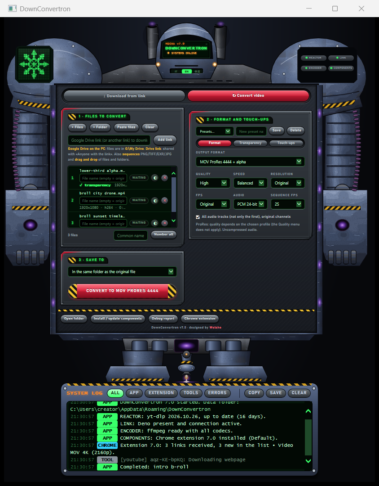
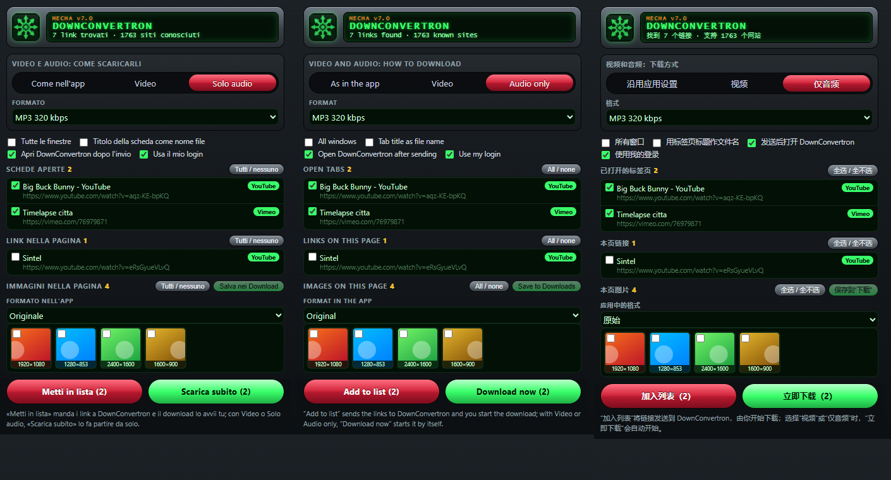
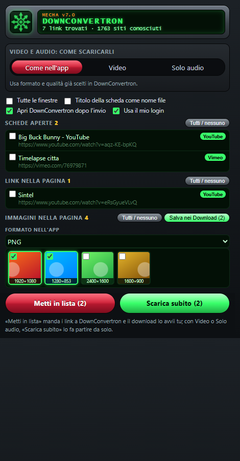
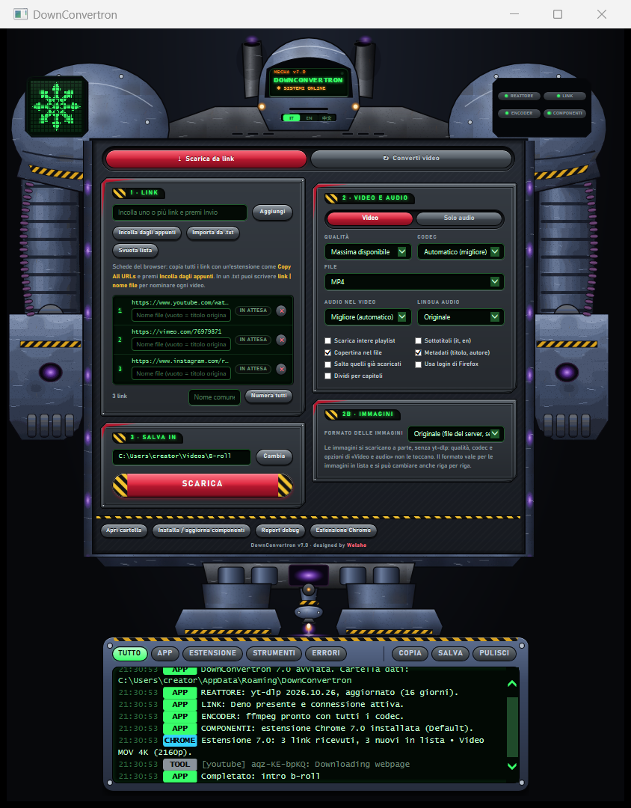
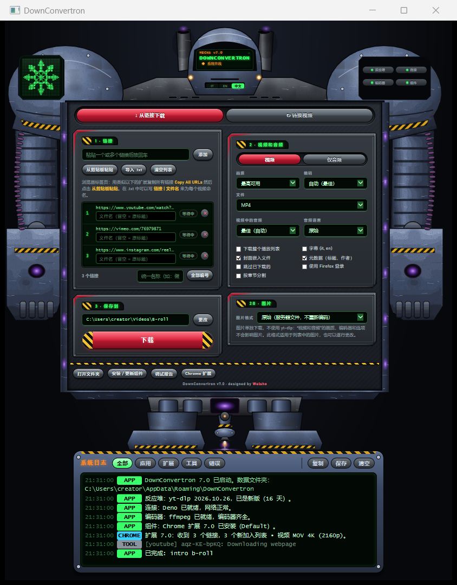

English · [Italiano](README.it.md)

# DownConvertron

**Download video, audio and images from the web in bulk. Convert them without losing the alpha channel.**
A front end for yt-dlp and ffmpeg, built for creators, streamers and video makers.

- **Bulk download, few clicks**: paste a list of links, or send your open tabs and the images on a page from the Chrome extension. Video, audio only, images.
- **Convert and keep transparency**: WebM VP9 + alpha, ProRes 4444, HAP Alpha, animated WebP/APNG, PNG/TIFF/EXR sequences.
- **Images to overlays**: several images become one animation or an image sequence, ready for OBS, Premiere, Resolve and LED walls.

**7.0 beta** · Windows 10/11 · macOS 13+ on Apple Silicon (experimental) · Chrome extension · [What has been tested](#status)

[Download](https://github.com/welsho/DownConvertron/releases) · Interface in Italian, English and 简体中文

[](https://github.com/welsho/DownConvertron/actions/workflows/build.yml)
[](https://github.com/welsho/DownConvertron/releases)
[](LICENSE)



Yes, the interface is a mecha. It turns around when you drop a file on it.

## What it does

- **Collects links from the browser.** The Chrome extension lists your open tabs, the links on the page and the images on the page. Tick them, then **Add to list** or **Download now**, with format and quality already chosen.
- **Video, audio and images in one list.** Video and audio come through [yt-dlp](https://github.com/yt-dlp/yt-dlp), from the sites yt-dlp supports (more than 1,700 extractors; some stop working when a site changes). Images come from direct links, saved as they are or as PNG, WebP or JPG, with their own settings box.
- **Keeps transparency in every format that supports it.** WebM VP9 + alpha, ProRes 4444 and 4444 XQ, Animation, PNG in MOV, CineForm, HAP Alpha, animated WebP and APNG, PNG/TIFF/EXR sequences. Formats without alpha (MP4 H.264/H.265, ProRes 422, JPG) are labelled as such; with JPG the transparent parts become white.
- **Turns images into animations.** Several images become one animation, at the images-per-second rate you choose, or stay separate (the app asks). A single image becomes a still clip of the length you set, or another image file.
- **Touches up.** Trim, repeats, forward-backward loops, vertical / square / 4:5 canvas with transparent borders, chroma key, checkerboard preview, loudness normalisation (-14, -16 or -23 LUFS).
- **Uses the graphics card when there is one.** NVIDIA, Intel and AMD encoders on Windows, the Apple chip on Mac.
- **Runs on your computer.** No account, no telemetry, no server of ours. [What it does on your machine](#before-you-install).

## Workflows

**1 · B-roll in bulk.** Open the clips in Chrome while you research → DownConvertron icon → *Video*, container and quality → **Add to list**, then **Download** in the app (or **Download now** and it starts by itself). Use it for clips from your own channels, stock sites and libraries you have a licence for.

**2 · Overlays and alerts for the stream.** Drop a MOV with alpha on the mecha → *WebM VP9 + alpha* for browser sources in OBS, *ProRes 4444* for editing, *HAP Alpha* for media servers and LED walls. Check the result on the checkerboard preview before converting.

**3 · Images to animation.** Drop a set of PNGs on the mecha → answer *one animation* → pick the images per second in the row → *animated WebP*, *APNG*, *WebM VP9 + alpha* or a numbered sequence.

**4 · Loops, stingers and vertical clips.** Trim, *Forward-backward* for a seamless loop, *Repeats* to make it longer, *Canvas 1080×1920* with *Whole, transparent borders*.

**5 · Music and voice-over.** *Audio only*: WAV for editing, MP3 for drafts, or the original track with no conversion.

## Install

All files are on the [releases page](https://github.com/welsho/DownConvertron/releases). This is a pre-release: **Windows is the tested platform; the Mac app is a preview, not yet tried on a real Mac: testers wanted.** Details in [Status](#status).

### Windows 10 / 11
1. Download `DownConvertron-Setup.bat` and double-click it.
2. Windows SmartScreen warns you because the file is not signed: *More info → Run anyway*. Some antivirus programs will flag it too. [What the installer does](#before-you-install).
3. Open DownConvertron. If a light at the top is red, click it: it installs or updates that component.

The installer needs *App Installer* (winget), which Windows 10 and 11 normally include. The app does not ask for admin rights. Prefer not to install? `DownConvertron.hta` is the whole app in one file: double-click it and press **Install / update components**.

### Mac (Apple Silicon, macOS 13 or later) · preview
1. Download `DownConvertron-Mac-AppleSilicon.zip`, unzip it and drag **DownConvertron.app** to *Applications*.
2. Open it. macOS says it cannot verify the developer, or that the app is damaged. It is not signed with an Apple Developer ID and not notarized; that is what the message means. Go to *System Settings → Privacy & Security → Open Anyway*.
3. If macOS still refuses, open Terminal and run `xattr -dr com.apple.quarantine /Applications/DownConvertron.app`. This removes the mark macOS puts on downloaded files; it changes nothing else.
4. Press **Install / update components**: yt-dlp, ffmpeg and Deno (about 150 MB) go to `~/Library/Application Support/DownConvertron/bin`. No Homebrew, no password.

These steps have not been tried on a real Mac yet. If you try them, please [tell us how it went](https://github.com/welsho/DownConvertron/issues/new/choose).

### Chrome extension
1. In the app press **Chrome extension**: it prepares the extension folder, opens Chrome's *Extensions* page and shows the folder to load.
2. Turn on *Developer mode* and drag the folder onto the page. Once.

The extension is not on the Chrome Web Store: it is loaded from the folder the app prepares, so Chrome shows its usual notice about developer-mode extensions. Chrome does not let any program install an extension for you, which is why those two steps remain. [What it can access](#chrome-extension-permissions-and-login).

<p align="center"><br></p>

## Before you install

It is not signed. Here is, item by item, what it does on your computer and how to remove it.

- **Windows installer**: a `.bat` file that runs a PowerShell script stored inside itself (`-ExecutionPolicy Bypass`). Some antivirus programs will flag this pattern. It installs or updates yt-dlp, ffmpeg and Deno with winget (`yt-dlp.yt-dlp`, `yt-dlp.FFmpeg`, `DenoLand.Deno`), copies the app to `%LOCALAPPDATA%\Programs\DownConvertron`, creates shortcuts on the Desktop and in the Start menu, registers the `downconvertron://` link under `HKCU`, and removes the older versions of this app (DownLTransFMecchazzi, Mecchazzi, Scarica Video) while keeping their settings.
- **Windows app**: an HTA, run by Windows' own `mshta.exe` with your user's rights and no browser sandbox. At every start it writes two registry entries for your user only: `HKCU\Software\Classes\downconvertron` and `HKCU\Software\Google\Chrome\NativeMessagingHosts\com.welsho.downconvertron`. Its data lives in `%APPDATA%\DownConvertron`. The single-file `DownConvertron.hta` does the same without the installer.
- **Mac app**: ad-hoc signed, not notarized, so macOS blocks it until you allow it. Components are downloaded from GitHub (yt-dlp, Deno) and ffmpeg.martin-riedl.de (ffmpeg); each file is checked against its SHA-256 when the source publishes one, and the log says so when the check is skipped.
- **Chrome extension**: loaded by hand in Developer mode. It can read the pages and the cookies of any site. It has no background script: it works only while its popup is open.
- **"Use my login" is on by default** (you can switch it off). Every time you send links to the app, the extension also passes Chrome's cookies for the sites of those links, through a local bridge. They are written to an unencrypted file in the app's data folder, used only if the site asks you to sign in, then deleted. Whoever holds that file has access to your account on that site. [Full details below](#use-my-login-questions-and-answers).
- **Network**: the app talks to the sites you download from, to the sources of its components, and to `www.youtube.com/generate_204` (a tiny request, at start and every five minutes, that tells the LINK light whether you are online). No telemetry, no account, no update check, no server of ours.
- **Removing it**: on Windows, Start menu → *Uninstall DownConvertron* removes the app, the shortcuts, both registry entries, the bridge and any cookie file; your settings stay in `%APPDATA%\DownConvertron` until you delete that folder. On Mac, delete the app and `~/Library/Application Support/DownConvertron`. In Chrome, remove the extension from `chrome://extensions`.

Release files are built by GitHub Actions from the tagged source and listed with their checksums in `SHA256SUMS.txt`. The complete list, and how to report a vulnerability: [SECURITY.md](SECURITY.md).

## Status

| Part | Status |
|---|---|
| Windows app: download, conversion, images | Built and tried on one Windows 11 PC, plus automated tests of the same code in Electron on Linux. Not yet confirmed on other PCs |
| Windows: still to confirm on real PCs | Native drag-and-drop helper · COMPONENTS light and the automatic opening of Chrome's Extensions page · extension logo opening the app · image downloads through Windows' `curl.exe` · installing components with winget from the lights · layout at 100%, 125% and 150% display scale |
| Chrome extension: links and images | Automated tests in Chromium on Linux |
| Chrome extension: "Use my login" | Tried against a local test server (refused → retried with the login → downloaded), for a video and for an image. Not yet tried with real sites in a real Chrome profile |
| Mac app (Apple Silicon) | Preview. Never run on a real Mac; the interface code is the one tested in Electron on Linux |
| Screens less than about 950 px high | The window scrolls instead of fitting in one screen |

Found a problem, or tried it on a Mac? [Open an issue](https://github.com/welsho/DownConvertron/issues/new/choose).

## Formats

**Download** (the choices yt-dlp gets from the app): MP4, MKV, WebM, MOV, AVI, animated GIF, at the best quality the site offers or capped from 360p to 8K. Audio only: MP3, M4A, Opus, Vorbis, FLAC, WAV, or the original track. Playlists, subtitles, chapters, audio language. Images: original file, PNG, WebP or JPG.

**Convert**:

| Output | Alpha | Typical use |
|---|---|---|
| WebM VP9 | yes | OBS and other browser sources, web |
| MOV ProRes 4444 / 4444 XQ | yes | editing |
| MOV Animation, MOV PNG | yes | lossless intermediates |
| MOV CineForm (12-bit) | yes | editing |
| MOV HAP Alpha | yes | live playback, LED walls |
| MOV HEVC + alpha (Mac only) | yes | Apple software |
| Animated WebP, APNG | yes | web |
| Animated GIF | 1-bit | web |
| PNG / TIFF / EXR sequence | yes | compositing |
| Single image: PNG, WebP, TIFF | yes | stills |
| Single image: JPG | no (transparent parts become white) | stills |
| MP4 H.264, MP4 H.265, MOV H.264 | no | everywhere |
| MOV ProRes 422 (HQ, standard, LT, Proxy) | no | editing |
| MOV HAP, HAP Q | no | live playback |
| MP4 ↔ MOV container change | as in the source | no re-encoding when the codecs allow it |

Inputs: video files, animated images, numbered image sequences, single images, and direct links to images.

## Chrome extension: permissions and login

The extension works with Google Chrome. It contacts no server of ours: it reads the page you are on, loads the thumbnails of that page's images, and talks to the app on your computer.

| Permission | What it is used for | When |
|---|---|---|
| `tabs` | list the address and title of your open tabs | when you open the popup |
| `activeTab`, `scripting` | read the links, video sources and images of the active tab | when you open the popup |
| `clipboardWrite` | pass the list of links and settings to the app through the clipboard | when you press a send button |
| `downloads` | **Save to Downloads** for images | when you press it |
| `nativeMessaging` | talk to the local bridge: open the app, ask which links need a login, hand over cookies | popup opening, logo, send |
| `cookies`, access to all sites | "Use my login" | at every send, while the switch is on |

These permissions are fixed in the manifest: switching "Use my login" off stops the extension from reading cookies, but does not remove the permission.

### "Use my login": questions and answers

It is for videos you can already watch with your own account: age-restricted videos, memberships you pay for, private videos shared with you.

- **When are cookies read?** With the switch on (the default), every time you press **Add to list** or **Download now**, whether or not the site will need them. With the switch off, only when you press **Retry with my login**, which appears after a site has asked you to sign in.
- **Which cookies?** All the Chrome cookies of the base domain of each link you send, subdomains included (a link on `video.example.com` sends the cookies of `example.com`). Nothing from other sites.
- **Where do they go?** To a local bridge (Chrome native messaging) that Chrome starts only for this extension. The bridge writes them to `cookies/<random name>.txt` in the app's data folder. The clipboard carries only that random name, never the cookies.
- **When are they used?** Only when the site refuses the download and asks for a login: the app retries that link once, passing the file to yt-dlp (or to curl for images). With **Retry with my login** they are used straight away.
- **How long does the file stay?** It is deleted when the download run ends or is cancelled; as soon as no link in the list needs it (row removed, list cleared, already downloaded); after 30 minutes if the links sit in the list with no download running; when you close the app; and when the app starts again. If the app is closed, the bridge deletes files older than 10 minutes each time you open the extension.
- **What should I know?** The file is plain text for as long as it exists. Chrome keeps cookies encrypted; this file is not. Whoever has that file has access to your account on that site. If the app crashes or the computer is switched off, the file stays until the app starts again or you open the extension.
- **Can I turn it off?** Yes, with the **Use my login** switch in the extension.

The app also has its own **Use Firefox login** option. It is off by default and is not remembered when you reopen the app. When ticked, yt-dlp reads the cookies directly from your Firefox profile for every link of that download (`--cookies-from-browser firefox`); DownConvertron writes no cookie file in that case. Use it only with lists of links you trust.

## Requirements and known limits

- Windows 10 or 11 with winget, or a Mac with Apple Silicon and macOS 13 or later. No Intel Mac build, no Linux build.
- Internet access to install yt-dlp, ffmpeg and Deno. DownConvertron does not bundle them: it installs them on your computer from their own sources.
- The extension is for Google Chrome. There is no Firefox or Web Store version.
- On Windows the app needs `mshta.exe`. Where an organisation blocks it, the app will not start.
- The layout is designed to fit one screen at 1080 px of height. Below about 950 px the window scrolls.
- When a site stops working, the first thing to do is update yt-dlp (click the REACTOR light). Site support is yt-dlp's work, not ours: please do not ask the yt-dlp project for help with DownConvertron.
- DRM-protected content is not supported.
- The mecha's one-liners stay in Italian. That is on purpose: it is part of the character.

## Responsible use

DownConvertron is a tool. What you download with it is your responsibility.

- Download only content you own or are allowed to use: your own, public domain, Creative Commons, or licensed to you.
- Respect the terms of service of the sites you use and the copyright law of your country.
- DownConvertron does not remove DRM and does not host, index or distribute any content.
- "Use my login" uses your own account, on your own computer, for content you can already watch. Do not use it with accounts that are not yours. A site may restrict an account that is used for downloads.

DownConvertron is an independent project, not affiliated with or endorsed by yt-dlp, FFmpeg, Deno, Electron, Google or any of the sites it can download from. All trademarks belong to their owners. The software is provided "as is", without warranty of any kind: see the [licence](LICENSE).

## The mecha

<table>
<tr>
<td width="50%"><br><sub>The download tab, in Italian.</sub></td>
<td width="50%"><br><sub>The download tab, in Simplified Chinese.</sub></td>
</tr>
</table>

- **Lights**: REACTOR (yt-dlp), LINK (Deno and connection), ENCODER (ffmpeg and its codecs), COMPONENTS (the Chrome extension, as found in Chrome's profile). Green when all is well, red when something is missing, does not start or is outdated (yt-dlp older than 60 days). Click a light to install or update that part.
- **Status screen**: under the mecha's feet, the full log of app, extension and tools, with filters (ALL, APP, EXTENSION, TOOLS, ERRORS), COPY and SAVE. The **Debug report** button collects what is needed for a bug report.
- **Language**: IT · EN · 中文 in the slot under the helmet vents. The extension follows the app's language.

## For developers

```
src/DownConvertron.hta        the app: single source (HTML + JScript ES3 for mshta / IE11 engine)
mac/                          Mac layer: Electron (shim of the Windows APIs, main process, bridge, build)
windows/                      installer builder, bridge, drag-and-drop helper (C# + PowerShell), launcher
extension/                    Chrome extension (Manifest V3)
i18n/strings.json             translations: Italian sentence -> en, zh
tools/                        embedding of generated parts, checks, site list, mecha drawing
tests/electron/               automated tests on the Electron app (they run on Linux too)
docs/                         README images, release text
.github/workflows/build.yml   checks on every push; on a v* tag, build and draft release
```

Build (Python 3, Node.js, `zip`; signing the Mac app needs macOS or [rcodesign](https://github.com/indygreg/apple-platform-rs)):

```bash
npm install
./build.sh                 # dist/: Windows installer, HTA, Mac app, extension
SKIP_MAC=1 ./build.sh      # Windows and extension only
python3 tools/check.py     # must end with "RISULTATO: TUTTO OK"
```

Project rules:
- There is one source: `src/DownConvertron.hta`. The Mac app (`mac/build_mac.py`) and the installer (`windows/build_installer.py`) are generated from it.
- The script inside the HTA must stay **ES3**: no `let`, `const`, arrow functions, template strings or trailing commas. `tools/check.py` verifies it.
- Some parts of the HTA are generated (extension files, bridge, drag-and-drop helper, mecha, translations). Do not edit them by hand: change the originals and run `python3 tools/embed.py`.
- System functions exist twice: in the HTA for Windows and in `mac/src/mac.js` for the Mac.
- New interface texts are written in Italian; `python3 tools/i18n_extract.py` lists the ones still missing from `i18n/strings.json`. Comments, identifiers and commit messages are in Italian.
- The alpha channel must be preserved in every conversion that supports it: try every change to the converter with transparent files.
- Pushing a `v*` tag builds everything on GitHub Actions and creates a draft release.

Bugs and ideas: [open an issue](https://github.com/welsho/DownConvertron/issues/new/choose), in English or Italian. Security problems: see [SECURITY.md](SECURITY.md).

## Thanks to

[yt-dlp](https://github.com/yt-dlp/yt-dlp) · [FFmpeg](https://ffmpeg.org) · [Deno](https://deno.com) · [Electron](https://www.electronjs.org) · [winget](https://github.com/microsoft/winget-cli) · the ffmpeg builds for Mac by [Martin Riedl](https://ffmpeg.martin-riedl.de)

## Licence

[GPL-3.0-or-later](LICENSE). You can use it, study it, change it and share it; modified versions you distribute stay free under the same licence.

<p align="center"><b>DownConvertron</b> · designed by <b>Welsho</b></p>
